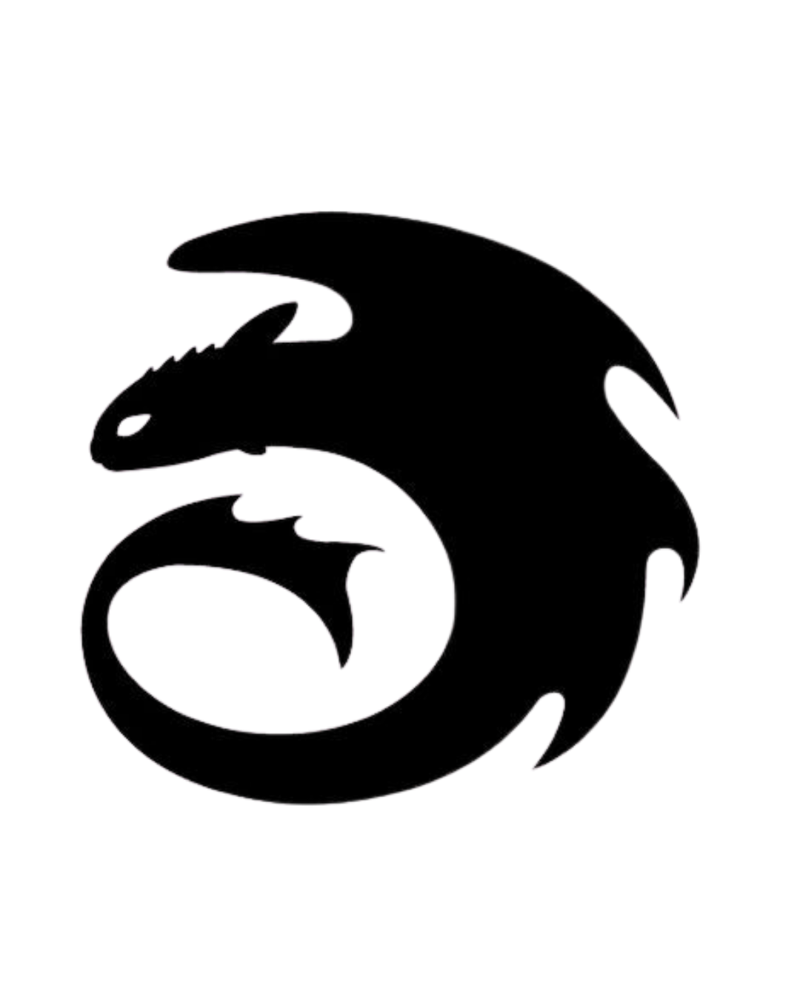

<p align="center">
  
</p>

<h1 align="center">Nullysh Forum</h1>

<p align="center">
  <strong>O hub da comunidade que constrói com método.</strong><br />
  Onde Nullyshers se encontram, aprendem, se destacam — e monetizam.
</p>

<p align="center">
  <em>O fórum VIP para quem constrói com método.</em>
</p>

<p align="center">
  <a href="https://github.com/netty-linux/nullysh-forum">
    
  </a>
  &nbsp;
  <a href="https://github.com/netty-linux">
    
  </a>
  &nbsp;
  <a href="https://github.com/netty-linux/nullysh-pay">
    
  </a>
</p>

<p align="center">
  <a href="https://nullysh-forum.ngdigitalsuporte.workers.dev">
    
  </a>
  
  
</p>

<br />

---

<br />

## A ideia

> **Não é só um feed.**  
> É o ponto de encontro de uma geração que trata digital como ofício — com identidade, status e resultado.

O **Nullysh Forum** nasceu para concentrar, em um único hub, tudo o que uma comunidade de construtores precisa no dia a dia:

- **pertencer** — voz, perfil e presença  
- **evoluir** — conteúdo, trilhas e mentoria  
- **conquistar** — VIP, vault e reputação  
- **operar** — ferramentas próprias, inclusive pagamentos  

Um lugar com cara de rede social, alma de comunidade e ambição de plataforma.

<br />

---

<br />

## O Hub Nullysh

<p align="center">
  
</p>

<p align="center">
  <strong>Um centro. Várias portas. Uma identidade.</strong>
</p>

O Hub é a casa da operação Nullysh. Em vez de espalhar a comunidade em dezenas de abas e ferramentas desconectadas, tudo converge aqui: social, aprendizado, vault e economia digital.

```text
                    ┌─────────────────────┐
                    │   NULLYSH FORUM    │
                    │      ·  HUB  ·      │
                    └──────────┬──────────┘
           ┌───────────────────┼───────────────────┐
           │                   │                   │
     ┌─────▼─────┐       ┌─────▼─────┐       ┌─────▼─────┐
     │  Social   │       │ Aprendizado│      │   Vault   │
     │  & Rede   │       │  & Jornada │      │ & Economia│
     └───────────┘       └───────────┘       └───────────┘
```

| Pilar | Propósito |
|:------|:----------|
| **Social** | Feed, conversa, assuntos e reputação |
| **Aprendizado** | Trilhas, materiais, vídeos e mentorias |
| **Vault** | NullPass + Nullysh Pay — valor e monetização |
| **Agenda** | Eventos que movem a comunidade |

<br />

---

<br />

## Nullysh Forum

<p align="center">
  
</p>

<p align="center">
  <strong>A rede da comunidade Nullysh.</strong><br />
  Onde cada membro tem rosto, voz e trajetória.
</p>

O Forum é a camada social e de pertencimento do ecossistema. É onde Nullyshers publicam, discutem, se seguem, se destacam e constroem presença — free ou VIP — com identidade visual própria, emblemas, molduras e assuntos por hashtag.

Aqui a comunidade não é “público passivo”. É rede viva.

### O que vive no Hub

<table>
  <tr>
    <td width="56" align="center" valign="top">
      
    </td>
    <td>
      <strong>Feed</strong><br />
      O pulso diário da comunidade. Posts, mídia, música e interação no ritmo de uma rede moderna — limpa, rápida e legível.
    </td>
  </tr>
  <tr>
    <td width="56" align="center" valign="top">
      
    </td>
    <td>
      <strong>Bate-papo</strong><br />
      Conversa direta entre membros. Proximidade real, sem perder o contexto da comunidade.
    </td>
  </tr>
  <tr>
    <td width="56" align="center" valign="top">
      
    </td>
    <td>
      <strong>Perfil</strong><br />
      Identidade pública com @, bio, banner, links, interesses e emblemas. O e-mail fica privado — o mundo vê quem você é na Nullysh.
    </td>
  </tr>
  <tr>
    <td width="56" align="center" valign="top">
      
    </td>
    <td>
      <strong>Salvos</strong><br />
      O que importa fica guardado. Um arquivo pessoal do que a comunidade produziu e você não quer perder.
    </td>
  </tr>
  <tr>
    <td width="56" align="center" valign="top">
      
    </td>
    <td>
      <strong>Assuntos</strong><br />
      Salas temáticas por hashtag — do geral ao lounge VIP e aos anúncios oficiais. VIPs podem criar novos espaços de conversa.
    </td>
  </tr>
  <tr>
    <td width="56" align="center" valign="top">
      
    </td>
    <td>
      <strong>Trilhas</strong><br />
      Jornadas de aprendizado estruturadas. Progresso com direção — não só conteúdo solto.
    </td>
  </tr>
  <tr>
    <td width="56" align="center" valign="top">
      
    </td>
    <td>
      <strong>Materiais</strong><br />
      Biblioteca da operação: arquivos, packs e recursos para quem executa de verdade.
    </td>
  </tr>
  <tr>
    <td width="56" align="center" valign="top">
      
    </td>
    <td>
      <strong>Vídeos</strong><br />
      Conteúdo em movimento — aulas, bastidores e drops com a linguagem da comunidade.
    </td>
  </tr>
  <tr>
    <td width="56" align="center" valign="top">
      
    </td>
    <td>
      <strong>Mentorias</strong><br />
      Acesso a quem já está na frente. Orientação com rosto e responsabilidade.
    </td>
  </tr>
  <tr>
    <td width="56" align="center" valign="top">
      
    </td>
    <td>
      <strong>NullPass</strong><br />
      O vault VIP: catálogo exclusivo, combos e ofertas para quem está dentro do círculo premium.
    </td>
  </tr>
  <tr>
    <td width="56" align="center" valign="top">
      
    </td>
    <td>
      <strong>Eventos</strong><br />
      A agenda da comunidade — encontros, lives e marcos que mantêm a energia coletiva.
    </td>
  </tr>
  <tr>
    <td width="56" align="center" valign="top">
      
    </td>
    <td>
      <strong>Camada VIP</strong><br />
      Lounge exclusivo, criação de assuntos, molduras, banners animados, músicas no perfil e acesso premium a conteúdo.
    </td>
  </tr>
  <tr>
    <td width="56" align="center" valign="top">
      
    </td>
    <td>
      <strong>Verificação & staff</strong><br />
      Selo de perfil, moderação e painel de operação — confiança e ordem em escala.
    </td>
  </tr>
</table>

<br />

---

<br />

## Nullysh Pay

<p align="center">
  
</p>

<p align="center">
  <strong>O gateway de pagamentos da Nullysh.</strong><br />
  Feito para quem vende. Conectado a quem já é da comunidade.
</p>

<p align="center">
  
</p>

O **Nullysh Pay** é a camada econômica do ecossistema: um gateway de pagamentos com a estética e a identidade Nullysh — para merchants comercializarem produtos, ofertas, infoprodutos e experiências digitais.

Ele **não é um “extra” dentro do feed**. É uma plataforma irmã, com vida própria, ligada ao Forum por uma conta unificada:

| | |
|:--|:--|
| **No Forum** | Entrada e vínculo da conta — “continuar com Nullysh Forum” |
| **No Pay** | Dashboard de merchant: produtos, checkouts, vendas, verificação e saques |

### A promessa

> **Mesma comunidade. Nova capacidade de cobrar, receber e escalar.**

- Conta merchant vinculada ao cadastro do Forum  
- Experiência de gateway profissional (no estilo de um pagamentos sério — com a cara Nullysh)  
- Verificação de conta, vendas e saques no fluxo do merchant  
- Separado do Forum de propósito: escala sem engessar a rede social  

Repositório dedicado: **[netty-linux/nullysh-pay](https://github.com/netty-linux/nullysh-pay)**

<br />

---

<br />

## Por que isso importa

| Antes | Com o Hub Nullysh |
|:------|:------------------|
| Comunidade espalhada | Um só ponto de presença |
| Conteúdo solto | Trilhas, vault e agenda |
| Status invisível | VIP, emblemas, verificação |
| Monetização de fora | Nullysh Pay no ecossistema |

O Hub existe para uma coisa simples e difícil:

**fazer a Nullysh se sentir como um mundo — não como um link.**

<br />

---

<br />

## Free e VIP

<p align="center"><strong>Dois níveis. Uma comunidade.</strong></p>

| | Free | VIP |
|:--|:----:|:---:|
| Rede, feed e perfil | ● | ● |
| Assuntos abertos | ● | ● |
| Lounge e criação de assuntos | | ● |
| Identidade premium (molduras, GIF, músicas) | | ● |
| Vault NullPass & conteúdo exclusivo | | ● |
| Acesso ao Nullysh Pay (merchant) | ● | ● |

Free entra e participa.  
VIP **pertence em outra profundidade**.

<br />

---

<br />

## Experiência

```text
  Feed · Bate-papo · Perfil · Salvos · Assuntos
  Trilhas · Materiais · Vídeos · Mentorias
  NullPass · Nullysh Pay · Eventos
```

- Visual **light / dark** com superfícies em camadas  
- Tipografia **Inter** (interface) + **Satoshi** (marca e títulos)  
- Motion contido, legibilidade alta, sensação de produto premium  
- Identidade própria — sem cara de template genérico  

<br />

---

<br />

## Ecossistema

```text
  ┌──────────────────┐         ┌──────────────────┐
  │  NULLYSH FORUM  │  SSO    │   NULLYSH PAY    │
  │  Comunidade Hub  │ ──────► │  Gateway merchant │
  └──────────────────┘         └──────────────────┘
           │
           ▼
     Nullyshers · VIP · Staff
```

| Produto | Papel |
|:--------|:------|
| **[Nullysh Forum](https://github.com/netty-linux/nullysh-forum)** | Hub social, aprendizado e vault |
| **[Nullysh Pay](https://github.com/netty-linux/nullysh-pay)** | Gateway de pagamentos da marca |

<br />

---

<br />

## Criador

<p align="center">
  <a href="https://github.com/netty-linux">
    
  </a>
</p>

<p align="center">
  <strong><a href="https://github.com/netty-linux">ɴᴇᴛᴛʏ ❋</a></strong><br />
  <sub>@netty-linux</sub>
</p>

<p align="center">
  Fundador e dono da operação <strong>Nullysh</strong>.<br />
  Constrói o Hub, a comunidade e as ferramentas em volta — com método.
</p>

<p align="center">
  <a href="https://github.com/netty-linux">
    
  </a>
  &nbsp;
  <a href="https://github.com/netty-linux?tab=repositories">
    
  </a>
</p>

<br />

---

<br />

## Links

| | |
|:--|:--|
| **Forum (live)** | [nullysh-forum.ngdigitalsuporte.workers.dev](https://nullysh-forum.ngdigitalsuporte.workers.dev) |
| **Este repositório** | [github.com/netty-linux/nullysh-forum](https://github.com/netty-linux/nullysh-forum) |
| **Nullysh Pay** | [github.com/netty-linux/nullysh-pay](https://github.com/netty-linux/nullysh-pay) |
| **Perfil do criador** | [github.com/netty-linux](https://github.com/netty-linux) |

<br />

---

<br />

<p align="center">
  
  &nbsp;&nbsp;
  
</p>

<p align="center">
  <strong>Nullysh</strong> — comunidade, conteúdo e economia digital no mesmo ecossistema.
</p>

<p align="center">
  <sub>
    Feito com intenção por
    <a href="https://github.com/netty-linux"><strong>ɴᴇᴛᴛʏ</strong></a>
    · Nullysh Forum &amp; Nullysh Pay
  </sub>
</p>
