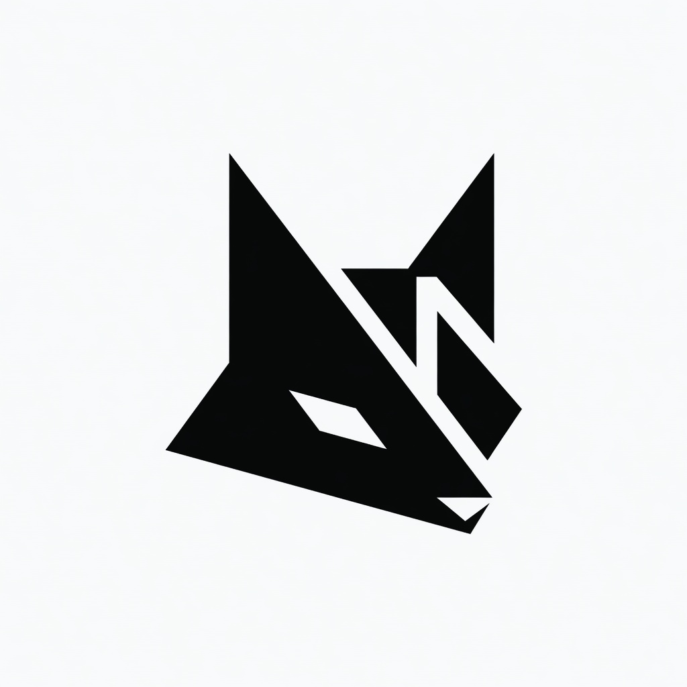

<p align="center">
  
</p>

<h1 align="center">Nullysh Forum</h1>

<p align="center">
  <strong>A rede social da comunidade Nullysh.</strong><br />
  Feed, perfis, assuntos por hashtag, VIP e conteúdo exclusivo — em um só lugar.
</p>

<p align="center">
  <a href="https://github.com/netty-linux/nullysh-forum"></a>
  
  
  
</p>

---

## O que é

O **Nullysh Forum** é o hub social da operação Nullysh: um fórum com cara de rede social, feito para membros free e VIP construírem, trocarem e consumirem conteúdo com identidade própria.

Não é só um feed. É o lugar onde a comunidade se encontra, se destaca e evolui.

---

## Como funciona

### Feed social
Publique pensamentos, imagens e localização. Curta, salve, comente e interaja no estilo de uma rede moderna — limpa, rápida e legível.

### Perfis com identidade
Nome público (`@username`), bio, banner (incl. GIF para VIP), links, interesses, objetivos, emblemas e molduras. O e-mail fica privado; o @ é o que o mundo vê.

### Assuntos por hashtag
Cada assunto tem uma palavra-chave. Marque a tag no post e ele sincroniza automaticamente:

| Assunto | Tag | Quem marca | Quem lê |
|------------|-----|------------|---------|
| Anúncios Oficiais | `#staff` | Admin | Todos |
| Geral | `#geral` | Todos | Todos |
| Lounge VIP | `#vips` | VIP | VIP |

VIPs podem **criar** novos assuntos e definir se free ou só VIP leem os posts. Ao digitar `#`, o autocomplete sugere as tags disponíveis.

### VIP
Acesso a lounge exclusivo, criação de assuntos, molduras de avatar, banners animados, músicas no perfil e mais. Free usa o núcleo; VIP desbloqueia a camada premium.

### Social
Seguir, lista de seguidores/seguindo, bloquear, stories, bate-papo e perfis públicos. Controles claros, sem confusão.

### Conteúdo & jornada
Trilhas, mentorias, eventos, vídeos e materiais — o lado de aprendizado e operação da comunidade, ao lado da rede social.

### Staff & verificação
Assuntos oficiais do staff, painel admin e selo de perfil verificado para reduzir fakes e manter a base confiável.

---

## Experiência

```
Feed  ·  Trilhas  ·  Materiais  ·  Mentorias  ·  Eventos
Assuntos  ·  Vídeos  ·  Bate-papo  ·  Perfil  ·  Salvos
```

- **Light / Dark** com superfícies em camadas  
- Tipografia **Inter** (UI) + **Satoshi** (display)  
- Motion contido, alvos de toque e estados de foco consistentes  
- Design system tokenizado (espaçamento, radius, sombra, texto)

---

## Planos

| | Free | VIP |
|---|:---:|:---:|
| Feed & perfis | ✓ | ✓ |
| Assuntos abertos (`#geral`) | ✓ | ✓ |
| Criar assuntos | | ✓ |
| Marcar / ler Lounge VIP (`#vips`) | | ✓ |
| Molduras, GIF banner, músicas | | ✓ |
| Conteúdo premium (vídeos, materiais) | | ✓ |

---

## Stack

| Camada | Tecnologia |
|--------|------------|
| App | Next.js 16 · React 19 · TypeScript |
| UI | Tailwind CSS 4 · Phosphor · Motion |
| Estado | Zustand (persist) |
| Backend | Supabase Auth · Profiles · Storage |
| Vídeos | Telegram Bot API (storage) + ffmpeg.wasm + KV/R2 |
| Host | Cloudflare Workers (OpenNext) — free |
| Design | Tokens em `globals.css` · Inter + Satoshi |

---

## Preview na cloud (Cloudflare Workers)

**URL:** https://nullysh-forum.ngdigitalsuporte.workers.dev

Fluxo de desenvolvimento recomendado (sem `next dev` comendo RAM o dia todo):

1. Edite o código localmente
2. `git push` → ou `npm run deploy:wsl` (build no Linux/WSL)
3. Valide na URL do Worker

> OpenNext **não é estável no Windows**. Use `npm run deploy:wsl` ou o workflow GitHub Actions (`.github/workflows/deploy-cloudflare.yml`).

### Secrets do Worker
Já configuráveis com `wrangler secret put`:

| Secret | Uso |
|--------|-----|
| `TELEGRAM_BOT_TOKEN` | Bot storage de vídeos |
| `TELEGRAM_STORAGE_CHAT_ID` | Chat/canal do bot |
| `NEXT_PUBLIC_SUPABASE_URL` | Supabase |
| `NEXT_PUBLIC_SUPABASE_ANON_KEY` | Supabase |
| `ALLOW_HEADER_ADMIN=1` | Admin mock no preview (headers) |
| `ADMIN_API_SECRET` | (opcional) auth rígida de mutações |

### Storage free hoje
- **Catálogo de vídeos:** Workers KV (`NULLYSH_DATA`)
- **Arquivo:** Telegram (`file_id`)
- **Compactação:** **ffmpeg.wasm no browser** do admin (não no Worker)
- **Alvo sem R2:** ~18 MB (limite prático do `getFile` do Telegram para o player)
- **Com R2** (ative no dashboard e descomente no `wrangler.jsonc`): playback até ~48 MB

---

## Vídeos via Telegram (storage)

O **Bot do Telegram** guarda o arquivo; o fórum guarda metadados + `file_id`.

1. Admin sobe o vídeo no **Painel ADM → Vídeos**
2. Se grande → **ffmpeg.wasm compacta no navegador**
3. `POST /api/videos` envia ao chat de storage (`sendVideo`) + grava catálogo (KV/R2/FS)
4. Membros assistem em `/app/videos` via `GET /api/videos/:id/stream` (token nunca no browser)

### Setup
1. Bot no [@BotFather](https://t.me/BotFather) → `TELEGRAM_BOT_TOKEN`
2. Canal privado + bot como **admin**
3. `chat_id` (canais costumam ser `-100…`) → `TELEGRAM_STORAGE_CHAT_ID`
4. Cole no `.env.local` (veja `.env.example`) e reinicie o dev server

Limite Bot API: **~50 MB**/upload. Em produção use também `ADMIN_API_SECRET`.

---

## Rodar local

```bash
npm install
cp .env.example .env.local
# preencha Supabase e/ou Telegram
npm run dev
```

Abra [http://localhost:3000](http://localhost:3000).

Com Supabase configurado (`NEXT_PUBLIC_SUPABASE_URL` + `NEXT_PUBLIC_SUPABASE_ANON_KEY`), auth e mídia usam o projeto remoto. Sem a key, o app opera em modo local.

Migrations SQL: pasta `supabase/migrations/`.

Deploy cloud (Windows + WSL):

```bash
npm run deploy:wsl
```

---

## Repositório

```
https://github.com/netty-linux/nullysh-forum
```

---

<p align="center">
  <sub>Nullysh Forum · Comunidade, conteúdo e operação em um só produto.</sub>
</p>
